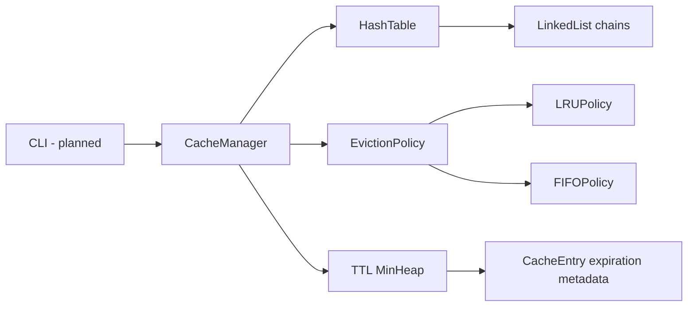

# MemDB — Lightweight In-Memory Key-Value Cache

**Team ID:** DSCPP-III-2026-T229
**Mentor:** Dr. Ravi Sharma
**Academic session:** 2026–27
**Repository:** [anish-mandal/memdb](https://github.com/anish-mandal/memdb)

## Overview

MemDB is an educational in-memory key-value cache written in pure C++. It stores
key-value data in RAM so that repeatedly requested data can be retrieved without
repeating the same slower lookup or computation. The project is intended to
demonstrate fundamental data structures, object-oriented programming, memory
management, and modular C++ application design.

MemDB is a PBL learning project, not a production-ready database. Its purpose is
to provide a clear implementation of cache concepts and a basis for correctness
testing and performance measurement.

## Problem Statement and Objectives

Applications often request the same data repeatedly. Recomputing or retrieving
that data each time can increase response time and resource usage. A cache keeps
frequently used data temporarily in memory and removes entries when capacity or
expiration rules require it.

The project objectives are to:

- Implement a custom hash table for key-based access.
- Handle hash collisions using separate chaining.
- Support key-value insertion, retrieval, updating, and deletion.
- Explore LRU (Least Recently Used) and FIFO (First In, First Out) eviction
  policies.
- Support TTL (time-to-live) expiration using a min-heap.
- Demonstrate data structures and object-oriented programming through an
  integrated C++ application.
- Test correctness and measure performance using benchmarks.

The core hash table, linked-list storage, cache manager, LRU/FIFO policies, TTL
min-heap, tests, application demo, and benchmark targets are present in the
current working tree. An interactive command-line interface, statistics, and
recorded benchmark analysis remain planned work.

## Team Members and Assigned Responsibilities

The following responsibilities are assigned project roles. They do not by
themselves represent proof that every assigned task is complete.

| Member | Student ID | Responsibility |
|---|---:|---|
| Anish Mandal | 2028642 | Custom hash table, linked-list storage, hash table tests, CLI, and integration |
| Arnav Rawat | 2028398 | Team lead and `CacheManager` |
| Priyanshi | 2028468 | LRU/FIFO eviction policies and eviction tests |
| Suhani Rawat | 2028504 | TTL min-heap, cache/TTL tests, and benchmarks |

## Technologies and Tools

- **Language:** C++17
- **Build system:** CMake 3.16 or newer
- **Standard library:** C++ standard library containers, utilities, time
  facilities, and optional values
- **Version control:** Git
- **Repository hosting:** GitHub
- **Compiler:** Any C++ compiler with C++17 support

The project currently uses no external libraries, frameworks, databases, or
runtime dependencies.

## Architecture and Modules

- **`CacheEntry`** represents a stored key-value entry and its creation and
  expiration metadata.
- **`HashTable`** provides custom key-based storage and uses separate chaining
  for collisions.
- **`LinkedList`** provides linked-list storage for hash-table collision chains.
- **`EvictionPolicy`** defines the shared interface for capacity eviction
  strategies.
- **`LRUPolicy`** removes the least recently accessed entry when capacity is
  exceeded.
- **`FIFOPolicy`** removes the oldest inserted entry when capacity is exceeded.
- **`MinHeap`** orders TTL expiration records so the earliest expiration can be
  processed first.
- **`CacheManager`** coordinates cache operations, capacity, expiration, and
  eviction.
- **CLI** is planned as an interactive interface for demonstrating cache
  operations. The current `app/main.cpp` is a small demonstration program, not
  yet a full command interpreter.

The intended high-level flow is:



## Major Features

| Feature | Status | Description |
|---|---|---|
| `SET(key, value)` | Implemented | Inserts a new entry or updates an existing value through `CacheManager::set`. |
| `GET(key)` | Implemented | Retrieves an existing value and returns no value for a missing or expired key. |
| `DELETE(key)` | Implemented | Removes a key through `CacheManager::remove`. |
| `CLEAR()` | Implemented | Removes all entries and clears policy and expiration state. |
| Capacity-based eviction | Implemented | Removes entries when the configured capacity is exceeded. |
| LRU eviction | Implemented | Tracks accesses and evicts the least recently used key. |
| FIFO eviction | Implemented | Evicts keys in insertion order. |
| TTL expiration | Implemented | Uses expiration records and a min-heap to remove expired entries. |
| Cache statistics | Planned | Hit rate, miss rate, latency, and memory statistics are not currently exposed. |
| Interactive CLI commands | Planned | The current application is a demonstration, not an interactive command interpreter. |
| Benchmarking | In progress | A benchmark executable exists; repeatable result collection and analysis are not yet recorded. |

## Project Structure

```text
MemDB/
├── include/
│   ├── cache_entry.hpp
│   ├── cache_manager.hpp
│   ├── eviction_policy.hpp
│   ├── fifo_policy.hpp
│   ├── hash_table.hpp
│   ├── linked_list.hpp
│   ├── lru_policy.hpp
│   └── min_heap.hpp
├── src/
│   ├── cache_manager.cpp
│   ├── fifo_policy.cpp
│   ├── hash_table.cpp
│   ├── linked_list.cpp
│   ├── lru_policy.cpp
│   └── min_heap.cpp
├── app/
│   └── main.cpp
├── tests/
│   ├── test_cache.cpp
│   ├── test_eviction.cpp
│   ├── test_hash_table.cpp
│   ├── test_linked_list.cpp
│   └── test_ttl.cpp
├── benchmarks/
│   ├── benchmark.cpp
│   └── results/
├── build.py
├── CMakeLists.txt
├── README.md
└── .gitignore
```

The `benchmarks/results/` directory is currently empty. The `build/` directory
is generated locally by CMake and is ignored by Git.

## Prerequisites and Setup

Install or otherwise obtain:

- A C++17-compatible compiler, such as GCC, Clang, or MSVC.
- CMake 3.16 or newer.
- Git.
- Python 3 if using the optional `build.py` convenience script.

Clone the repository:

```bash
git clone https://github.com/anish-mandal/memdb.git
cd memdb
```

Configure the project:

```bash
cmake -S . -B build
```

Build all configured targets:

```bash
cmake --build build --parallel
```

Run the application demonstration:

```bash
./build/memdb_app
```

On Windows, run the generated executable from the selected configuration
directory, for example:

```powershell
.\build\Debug\memdb_app.exe
```

The project also provides a cross-platform Python helper for configure, build,
and test operations:

```bash
python3 build.py
```

On Windows, the equivalent command is commonly:

```powershell
py build.py
```

## Testing and Benchmarks

The test suite currently includes:

- Hash table insertion, updating, lookup, collisions, removal, and clearing.
- Linked-list insertion, updating, lookup, removal, and clearing.
- Cache manager operations and capacity behavior.
- FIFO and LRU eviction behavior.
- TTL expiration and immediate expiration behavior.

Configure and build before running the tests:

```bash
cmake -S . -B build
cmake --build build --parallel
ctest --test-dir build --output-on-failure
```

The benchmark target can be built and run with:

```bash
cmake --build build --target memdb_benchmark
./build/memdb_benchmark
```

On Windows, run the corresponding executable from the selected configuration
directory. Benchmark results are not currently stored in
`benchmarks/results/`, so no performance numbers, hit rates, latency values, or
memory measurements are reported here.

## Current Project Status

This status reflects the source files and CMake configuration currently present
in the working tree. It does not assign completion credit to individual team
members.

- [x] `CacheEntry` is implemented with key, value, creation time, and
  expiration metadata.
- [x] `LinkedList` storage is implemented.
- [x] Custom `HashTable` storage is implemented with separate chaining.
- [x] Automated tests are configured for the current modules.
- [ ] `CacheManager` operations are implemented.
- [ ] LRU eviction is implemented.
- [ ] FIFO eviction is implemented.
- [ ] TTL expiration is implemented with a min-heap.
- [ ] CMake build targets are configured.
- [ ] Interactive CLI commands are not implemented.
- [ ] Remaining application integration work is assigned to Anish Mandal.
- [ ] Benchmark results have not been recorded or analyzed.
- [ ] Cache hit, miss, latency, and resource-usage statistics are not exposed.

The latest local Git history includes commits for the initial structure, linked
list and hash table work, contribution documentation, and cache/eviction policy
interfaces. The remaining working-tree changes are not treated as individual
contribution evidence in this README.

## Limitations and Future Work

### Conceptual Limitations

- Data is stored only in RAM, so it is lost when the application exits or the
  process fails.
- The cache is local to one process and does not provide persistence,
  replication, or sharing across multiple application instances.
- The cache has a finite capacity, so entries can be removed by eviction or
  expiration while they are still needed.
- Cache contents can become stale when the original data source changes before
  an entry expires.
- Performance and memory usage depend on workload, key distribution, cache
  capacity, compiler, and execution environment.
- The current project is an educational implementation and does not provide
  production features such as authentication, access control, persistence, or
  network access.

### Future Work

- Complete the interactive CLI for `SET`, `GET`, `DELETE`, and `CLEAR` commands.
- Add cache hit, miss, latency, and memory-usage statistics.
- Improve test coverage for edge cases, policy transitions, and repeated TTL
  updates.
- Validate memory safety with suitable tooling and broader stress tests.
- Collect repeatable benchmark results and document the workloads and
  environment used.
- Review API behavior for invalid keys, zero capacity, and other boundary
  conditions.

## License

No license has been specified for this repository yet.
